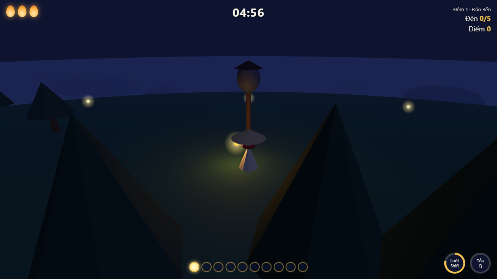
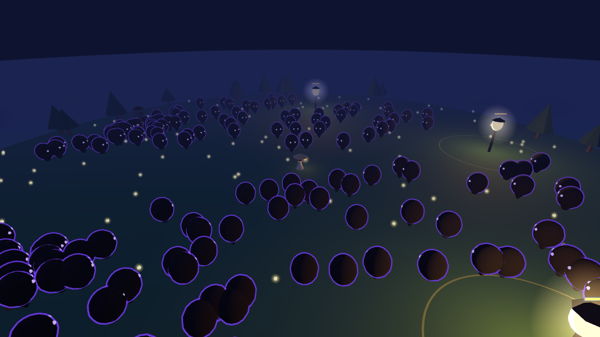

# Đảo Đèn Lồng v1.0.0

> **Video demo:** [demo.mp4 trong Release v1.0.0](../../releases/tag/v1.0.0) · Bài lab Day 12 AI SDLC, cá nhân, Bùi Mạnh Linh, 2A202603539. Luật lab: [LAB.md](LAB.md)

Game 3D góc nhìn thứ ba chạy trên trình duyệt (Three.js). Bạn điều khiển Mây, cô bé giữ đèn đội nón lá: gom đom đóm, thắp và **giữ cho các Đèn Lồng Lớn cháy tới bình minh** trên 3 hòn đảo, né Bóng Mực hút dầu đèn và Gió Lạc cướp đom đóm.




## Yêu cầu hệ thống

- macOS, Linux hoặc Windows. **Node.js ≥ 20** (đã kiểm tra với Node 20, 22 trên CI và Node 24 trên máy dev).
- Trình duyệt có WebGL2 (Chrome, Edge, Firefox, Safari bản mới).
- Benchmark: `npm install` tự tải Chromium (Chrome for Testing) qua puppeteer, khoảng 170 MB. Cần môi trường có màn hình để mở cửa sổ 1280×720.

## Cài đặt và chạy (3 lệnh)

```bash
git clone <repo> && cd <repo>
npm install
npm start          # mở http://localhost:5173
```

- Nếu cổng 5173 đang bận: `PORT=5174 npm start` (macOS/Linux) hoặc `$env:PORT=5174; npm start` (PowerShell).
- Tham số URL: `?night=2` vào thẳng Đêm 2, `?fps` hiện đồng hồ FPS (hoặc bấm F3).
- **Bản web tĩnh** (không cần Node): tải `dao-den-long-v1.0.0-web.zip` trong Release, giải nén rồi phục vụ thư mục bằng static server bất kỳ, ví dụ `python3 -m http.server 8000`. Ở bản này bảng xếp hạng lưu trong trình duyệt.

## Điều khiển (đổi được trong Cài đặt)

| Phím mặc định | Tác dụng |
|---|---|
| W A S D | Di chuyển (theo hướng camera) |
| Kéo chuột / ← → | Xoay camera |
| Space | Nhảy |
| Shift trái | Lướt |
| E | Nạp ánh sáng / châm dầu cho đèn |
| Q | Tỏa Sáng (tốn 3 đom đóm) |
| P / Esc | Tạm dừng |

**Cài đặt:** âm lượng, độ nhạy chuột, đổi phím cho mọi hành động (có cảnh báo khi trùng phím và nút "Khôi phục mặc định"), bảng màu dễ phân biệt, giảm chuyển động (tắt rung camera và chớp màn hình), chữ lớn ×1.25. Mọi cài đặt được lưu lại. Chữ giao diện tối thiểu 18 px; phụ đề báo Bóng Mực xuất hiện (kèm mũi tên ở mép màn hình), gió sắp thổi, 10 giây cuối và đèn sắp cạn dầu.

## Luật và cách tính điểm

- Đêm 1/2/3 (Đảo Bến, Đảo Cau, Đảo Chuông) dài 240/270/300 s. **Thắng** khi tới bình minh Mây còn sống và số đèn đang sáng ≥ 3/5, 4/6, 5/7. Hết 3 Ngọn Lửa thì thua.
- Đèn vừa thắp có 100 dầu, hao 1 dầu/giây. Bấm E ở đèn đang sáng để châm dầu (+10 dầu mỗi đom đóm). Đèn từng sáng chỉ cần 5 đom đóm để thắp lại. Đèn có dầu < 30 mất vùng an toàn và bị Bóng Mực hút dầu.
- Sức chứa = 10 + 2 × số lần thắp, tối đa 20. Bị chạm: −1 lửa, rơi một nửa số đom đóm. Rơi xuống biển mây: −1 lửa, mất hết đom đóm.

| Sự kiện | Điểm |
|---|---|
| Mỗi đom đóm nạp vào đèn | +5 |
| Thắp lần đầu / thắp lại | +100 / +40 |
| Bóng Mực trúng Tỏa Sáng | +5 (+15 nếu nó đang hút dầu) |
| Bình minh (khi thắng): mỗi đèn sáng / mỗi Ngọn Lửa | +50 + phần nguyên số dầu còn lại / +50 |

**Bảng xếp hạng:** sau màn Bình Minh hoặc khi thua, nhập tên 3–12 ký tự (chữ có dấu tiếng Việt, số, `_`) để lưu. Hệ thống giữ top 10 trong `data/leaderboard.json` (đổi thư mục bằng biến `DDL_DATA_DIR`), xem được từ menu chính. Xuất ra file:

```bash
node server.js --export-leaderboard out.json     # {"entries": [...]} đúng thứ tự xếp hạng
```

## Kiểm thử, headless, benchmark, soak

```bash
npm test                                                   # 90 test: unit, CLI, 27 scenario headless, bench scene, soak, leaderboard
node src/headless.js --seed 1 --night 1 --ticks 600 --out out.jsonl [--scenario s.json] [--inputs i.json]
node scripts/bench.js --seed 42 --duration 30 --out bench.json     # bench_cmd (mở cửa sổ Chromium 1280×720)
node --expose-gc --max-semi-space-size=1 --single-threaded --no-opt scripts/soak.js --seed 7 --nights 10 --out soak.json   # soak_cmd
npm run proof -- 4                                         # sinh bằng chứng vào docs/proof/phase-4/
```

- Contract: [game.contract.json](game.contract.json), Test Contract **v1.3**.
- **Bench:** chạy bản web trong Chromium do puppeteer điều khiển. Vsync tắt bằng cờ `--disable-gpu-vsync --disable-frame-rate-limit`. `peak_mem_mb` là tổng RSS của cả cây tiến trình Chromium. Thêm `--headless` nếu máy không có màn hình (số đo khi đó không chuẩn).
- **Soak:** các cờ V8 giới hạn semi-space và tắt các luồng nền để RSS ổn định (lý do ở [docs/notes/phase-4.md](docs/notes/phase-4.md)).
- Kết quả trên máy dev: [bench.json](docs/proof/phase-4/bench.json) (avg 632.7 FPS, p1 low 378.3, load 3044 ms), [soak.json](docs/proof/phase-4/soak.json) (0 crash, RSS 48.5 → 52.1 MB).

## Cấu trúc

```
src/sim/          logic thuần, tất định: game.js (thứ tự tick), maps.js, bench.js (cảnh bench chuẩn)
src/headless.js   CLI Test Contract · src/leaderboard*.js  bảng xếp hạng
server.js         web server + API bảng xếp hạng + --export-leaderboard
web/              Three.js renderer, HUD, menu, cài đặt, âm thanh (không chứa luật chơi)
scripts/          bench.js, soak.js, proof.js, build-web.js, run-tests.js, stop-gate.js
tests/            node:test + tests/scenarios/phase1..3.json
docs/notes/       spec, giả định, nhật ký AI từng phase, retro · docs/adr/  quyết định thiết kế · docs/proof/  bằng chứng
AGENTS.md, .claude/   harness AI (skill verify-game, Stop hook chặn kết thúc khi test đỏ)
```

## Tài liệu

- Ghi chép từng phase: [1](docs/notes/phase-1.md) · [2](docs/notes/phase-2.md) · [3](docs/notes/phase-3.md) · [4](docs/notes/phase-4.md) · **[Retro](docs/notes/retro.md)**
- Bằng chứng: [phase-1](docs/proof/phase-1/SUMMARY.md) · [phase-2](docs/proof/phase-2/SUMMARY.md) · [phase-3](docs/proof/phase-3/SUMMARY.md) · [phase-4](docs/proof/phase-4/SUMMARY.md)
- [ADR 0001](docs/adr/0001-lantern-fuel-and-dawn-win.md) · [CHANGELOG](CHANGELOG.md) · [CREDITS](CREDITS.md) · [LICENSE](LICENSE)

## Sáng tạo của tôi

Chỉ nằm trong phần hiển thị (`web/`), không đổi luật hay đầu ra headless, và tắt hoặc không ảnh hưởng trong cảnh bench:

- Chiếc đèn trên nón lá của Mây sáng to dần theo số đom đóm đang mang.
- Âm thanh tổng hợp bằng WebAudio, không dùng file: nhạc nền ngũ cung, chuông nhặt đom đóm, hợp âm thắp đèn, tiếng gió báo trước.
- Lời dẫn của Ông Đăng mở đầu mỗi Đêm. Đom đóm rơi nhấp nháy trước khi tắt. Gió Lạc là ba dải lụa uốn lượn.
